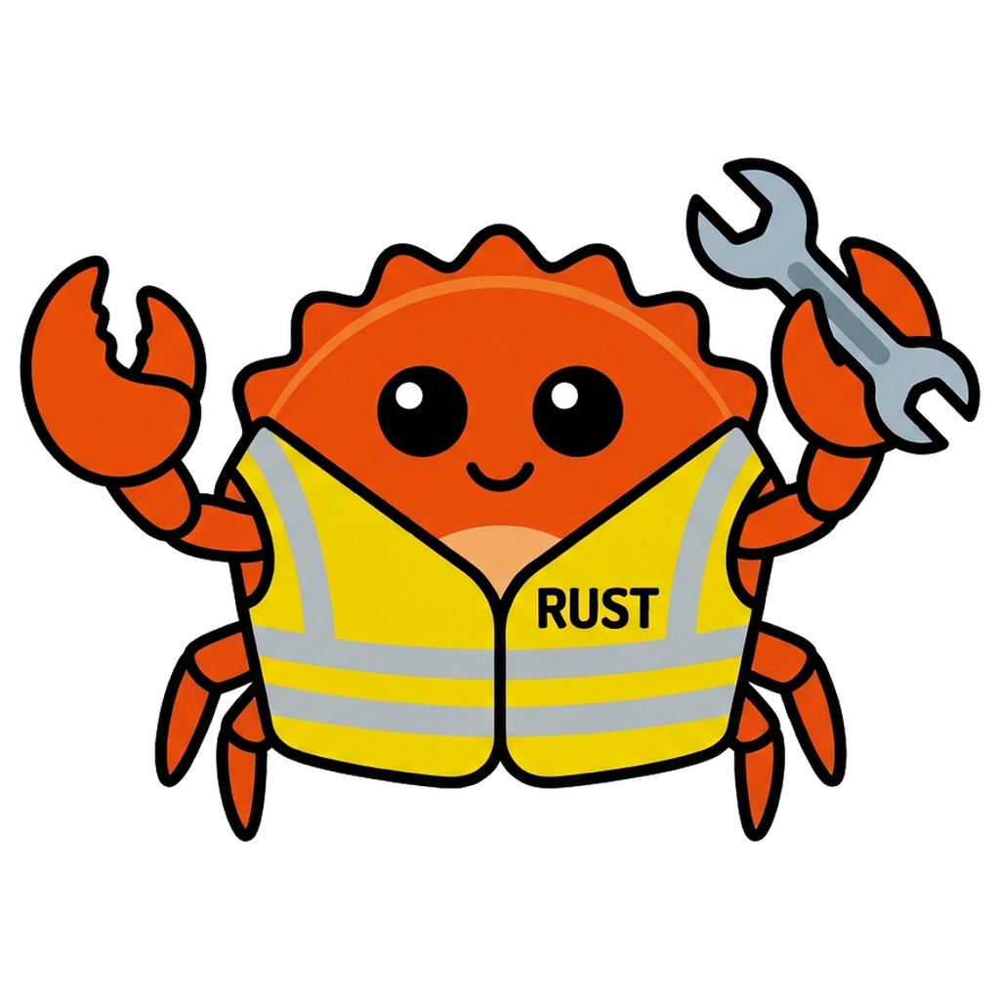

<p align="center">
  
</p>

<h1 align="center">UtilityCrab</h1>

<p align="center">
  A small Windows tray tool written in Rust that reads selected text aloud, takes and annotates screenshots, copies text from images and converts or shrinks images.
</p>

<p align="center">
  <a href="https://github.com/Sniphs98/UtilityCrab/releases/latest"><b>Download the latest version</b></a>
</p>

## Features

- **Read aloud:** select text anywhere and press a hotkey. Speech starts after the first sentence is ready, and pressing the hotkey again stops it.
- **Screenshots (Snipping Tool replacement):** press `Ctrl+Alt+A` (or use the tray menu) and pick a **rectangle**, a **window**, a **whole screen** or a **freeform** shape. A magnifier next to the cursor shows the pixels and their color; a single click in rectangle mode takes the window under the cursor. Delays of 3, 5 or 10 seconds are available. The screenshot is copied to the clipboard, optionally saved to `Pictures\Screenshots` or a folder of your choice (Settings → Screenshot), and opened in the editor.
- **Image editor:** edit screenshots or **existing photos** (open button / `Ctrl+O`, drag & drop, `Ctrl+V`, tray menu, or right-click an image in Explorer → **Mit UtilityCrab bearbeiten**). Tools:
  - pen, highlighter, eraser, arrow, line, rectangle, ellipse (filled or outlined, Shift for square/circle/45°), text (optionally on a colored box), numbered step markers 1, 2, 3 …
  - **redact** an area: pixelate, blur or black out
  - **automatically redact sensitive data**: OCR finds e-mail addresses, phone numbers, IBANs, credit card numbers (optionally IP addresses, links or all text) and covers them
  - spotlight (darkens everything except an area), crop, select & move, undo/redo, zoom (`Ctrl`+wheel, `Ctrl+0`/`Ctrl+1`) and pan (middle mouse or Space)
  - recognize text and copy it, **pin** the image to the screen (always-on-top window), copy, save as PNG, JPG, WebP or BMP
  - edits are copied to the clipboard automatically (can be turned off); each tool remembers its color and size
- **Text from screenshots (OCR):** snip a region of the screen and the recognized text lands in your clipboard; a popup shows what was copied. Uses the built-in Windows OCR.
- **Image converter:** right-click an image in Explorer → **Konvertieren** → convert it to PNG, JPG, WebP or ICO, or **Verkleinern** (shrink) it. Several selected files are handled in one go. Afterwards the new files are on the clipboard (paste them with Ctrl+V into a folder, chat or e-mail) and a small popup at the bottom center of the screen shows the progress in percent and then the result (size change, explanations, a button to show the file). Windows notifications can be chosen instead in the settings. **Weitere Optionen …** opens a window with every setting:
  - target format (PNG, JPG, WebP, BMP, GIF, TIFF, ICO), quality, resizing by longest edge or percent
  - a maximum file size in KB: quality and, if needed, resolution are lowered until the file fits
  - presets for e-mail, websites and "under 1 MB"
  - drag & drop of files and folders; the window can also be opened from the tray menu

  Reads PNG, JPG, WebP, BMP, GIF, TIFF and ICO, plus HEIC and AVIF through Windows codecs (install *HEIF Image Extensions* or *AV1 Video Extension* from the Microsoft Store). Originals are never changed. PNGs are optimized losslessly with [oxipng](https://github.com/shssoichiro/oxipng). Metadata such as GPS position is removed. On Windows 11 the menu is under **Show more options** (or Shift+right-click).
- **Multiple voice engines**, all running locally:
  - **Windows voices:** the voices built into Windows, no download needed.
  - **[Supertonic 3](https://huggingface.co/Supertone/supertonic-3):** natural-sounding neural TTS with 31 languages and 10 voices (~400 MB).
  - **[Piper](https://github.com/rhasspy/piper):** small, fast voices with accurate pronunciation (20–110 MB per voice).
- **Automatic language detection** per sentence. Piper and the Windows voices switch to an installed voice of the detected language.
- **Pronunciation dictionary** for words a voice gets wrong.
- **Settings window** to pick voice and speed, download or delete models, and change the hotkeys.
- **Updates:** installed versions check GitHub Releases once a day and offer a new version in a popup. One click downloads the setup, installs it silently and restarts UtilityCrab. Turn it off under **Info & Updates** in the settings, or check by hand from the tray menu (**Nach Updates suchen**).

## Default hotkeys

| Hotkey | Action |
|---|---|
| `Ctrl+Alt+S` | Read selected text / stop |
| `Ctrl+Alt+O` | Copy text from a screen snip |
| `Ctrl+Alt+A` | Take a screenshot |

Both hotkeys can be changed in the settings window, which you open by right-clicking the tray icon and choosing **Einstellungen …**.

## Building

Requires Windows 10/11 and a Rust toolchain with the MSVC target.

```sh
cargo run --release
```

Use the release build for everyday use. The neural voices are noticeably slower in debug builds.

### Installer

Requires [Inno Setup 6](https://jrsoftware.org/isinfo.php) (`winget install JRSoftware.InnoSetup`).

```powershell
.\installer\build.ps1
```

This builds the release and writes `dist\UtilityCrab-Setup-<version>.exe`. The setup installs per user (no admin rights), adds a Start menu entry and can register UtilityCrab to start with Windows. The version is also built into the exe (`UTILITYCRAB_VERSION`) for the update check; plain `cargo run` builds have none and don't check automatically.

### Releases

Every push to `main` builds the setup on GitHub Actions and publishes it as release `v<Cargo version>.<run number>`, for example `v0.1.0.7`. Installed copies pick it up through the update check.

## Extending the screenshot editor

The editor lives in `src/screenshot` and is built so new features are mostly one entry in a list:

| What | Where |
|---|---|
| New drawing tool | implement `Tool` (or use `DragTool` with a `make` function) and add it to `tools::all()` in `tools.rs`; toolbar button, shortcut, options bar and remembered style come with it |
| New kind of mark on the image | implement `Annotation` in `annotations.rs` (render onto a `Canvas`, bounds, hit test, move) |
| New toolbar action | add an `ActionDef` to `ACTIONS` in `editor.rs` (button, tooltip, shortcut, optional menu) |
| New pattern for automatic redaction | add a `Pattern` to `PATTERNS` in `redact.rs` |
| New capture mode | add a variant to `CaptureMode` in `overlay.rs` |
| New icon | add a `Glyph` in `icons.rs` |

The live preview renders the annotation being drawn onto a copy of just its area, with the same code as the final image, so what you see is exactly what gets saved.

## Popups

`src/popup` is a small reusable module for these popups: a `Notice` is built from blocks (progress, before/after stat, text, quote, hint, chip, details) and can be updated from another thread. The tray app shows them through a separate process (`--hinweis`, JSON lines on stdin). To check the design, run:

```sh
utility_crab.exe --hinweis-demo            # all states one after another
utility_crab.exe --hinweis-demo groesser   # one state, stays open
```

## Data

Settings, the error log and downloaded models are stored in `%LOCALAPPDATA%\UtilityCrab`. The screenshot editor remembers its tool styles in `screenshot.json` there; screenshots that were not saved are kept in `screenshots-temp` for a day.

## Notes

- The UI is in German.
- Models are downloaded from Hugging Face and GitHub on demand. Check each model's license before redistributing it: Supertonic 3 uses OpenRAIL-M, and Piper voices vary by speaker.
